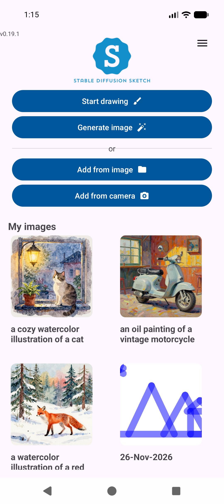
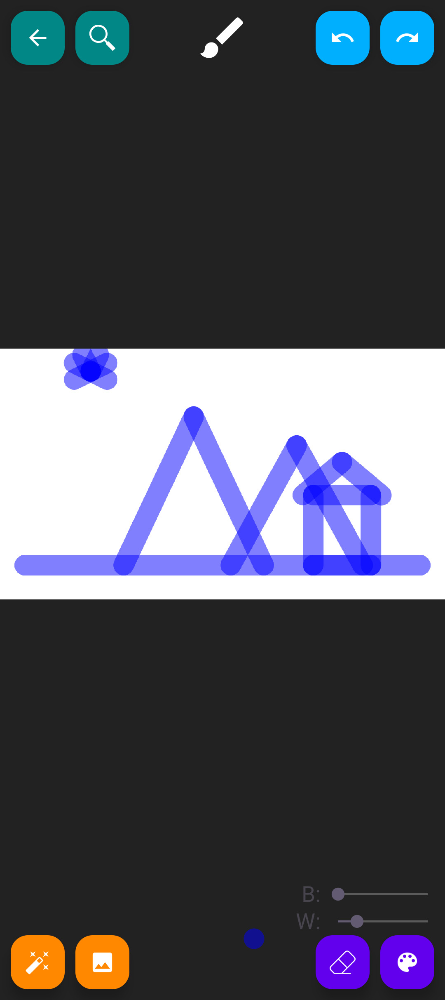
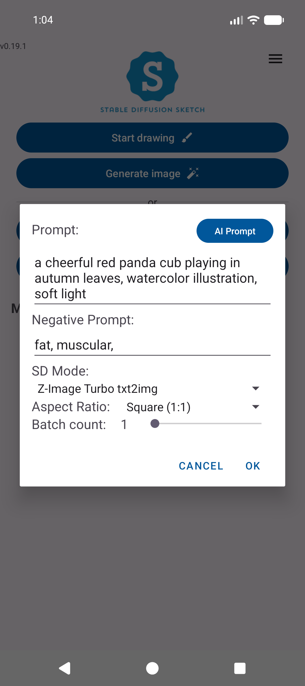
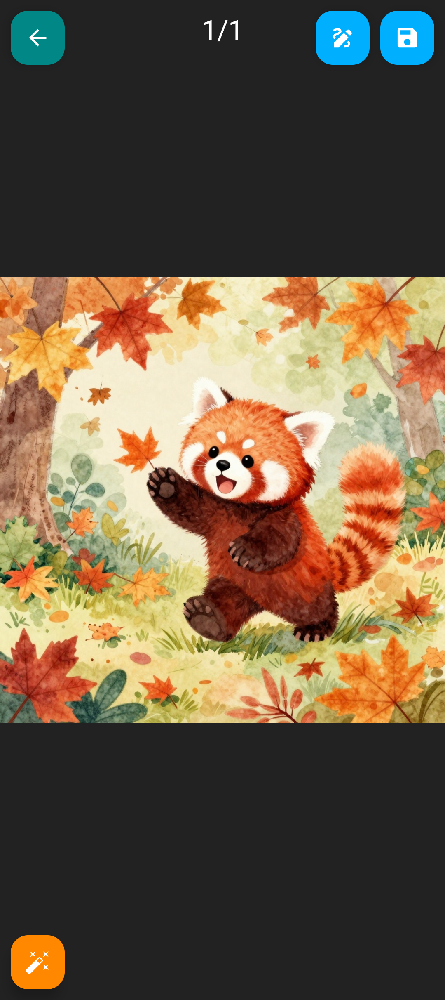
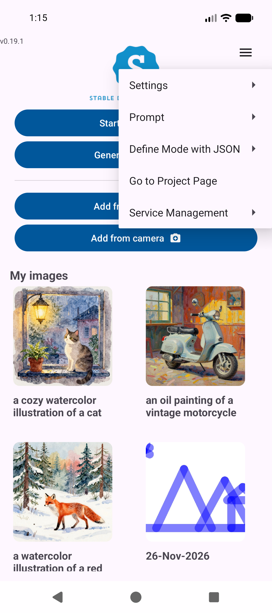
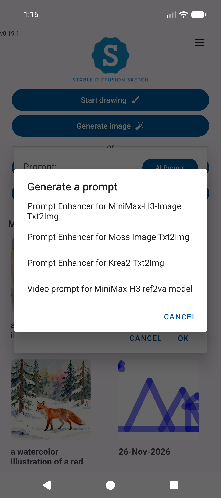

# Stable Diffusion Sketch [](https://github.com/jordenyt/stable_diffusion_sketch/releases/latest)

Sketch on your Android phone and turn your drawing into an AI image. The app talks to [ComfyUI](https://github.com/comfyanonymous/ComfyUI) through the [ComfyUI Restful API Gateway](https://github.com/jordenyt/ComfyuiGW), so any ComfyUI workflow published by the gateway is available inside the app.

**[Download Latest APK](https://github.com/jordenyt/stable_diffusion_sketch/releases/latest)**

## Key Features

- 🎨 **Draw with color** — brush with adjustable width and blur, palette, eyedropper, eraser, undo/redo, pinch zoom and pan
- 🖼️ **Four ways in** — blank canvas, camera capture, image from gallery, or share an image into the app from any other app
- ✨ **AI generation** — text-to-image, image-to-image (sketch), inpainting, reference-guided generation, upscaling and video, driven by the workflows published by the gateway
- 🧠 **AI Prompt** — let a text workflow (caption / prompt enhancer) rewrite your prompt for you
- 🔧 **Drawing tools** — reference image, brush-size preview, aspect ratios (1:1, 3:4, 4:3, 16:9), batch count 1–10, configurable output size (512–1280)
- 📈 **Live progress** — foreground notification with node progress and queue position, survives leaving the app
- 🗂️ **Project organisation** — results are grouped as projects, long-press to delete, EXIF metadata (prompt, steps, camera data) is written into the exported JPEG
- ⚙️ **Settings** — server address, default steps/CFG/size/batch, prompt prefix & postfix, negative prompt, per-mode parameter JSON, settings import/export

## Screenshots

| Home | Drawing | Generate |
|------|---------|----------|
|  |  |  |

| Result | Menu | AI Prompt |
|--------|------|-----------|
|  |  |  |

## Prerequisites

1. [ComfyUI](https://github.com/comfyanonymous/ComfyUI) running on a server
2. [ComfyUI Restful API Gateway](https://github.com/jordenyt/ComfyuiGW) (ComfyuiGW) running on the same server, with the workflows you want to use published
3. Android 8.0 (API 26) or newer

The app only talks to ComfyUI through the gateway.

## Setup Guide

1. **Start the gateway** — launch ComfyuiGW on your server; it listens on port `5000` by default and exposes the ComfyUI API used by the app
2. **Install the app** — download and install the APK on your Android device
3. **Configure the connection** — open the app, tap the menu (top right) → *Settings* → *ComfyUI GW Address* and enter the gateway address, for example `http://192.168.1.101:5000`
   - Local network: use the server's LAN IP
   - Remote access: forward the port on your router and use your public address or DDNS name
   - The address must be `http://host` or `http://host:port`
4. **Verify the connection** — open `http://[serverIP]:[port]/docs` in a browser; the Swagger UI must load and the app must stop showing *App not configured*
5. **Start creating** — sketch, type a prompt, and press *Diffuse now* or *Generate image*

## How It Works

The app does not embed any Stable Diffusion backend. It picks a **mode** published by the gateway, fills the mode's fields with your prompt, your drawing and the current settings, and submits it as a job:

| Step | Gateway endpoint | Purpose |
|------|------------------|---------|
| Mode list | `GET /mode_config` | Modes with their title, type and fields |
| LoRA list | `GET /loras` | `<lora:...>` autocompletion in the prompt box |
| Submit | `POST /comfyui_workflow` | Returns a `job_id` |
| Status | `GET /comfyui_status?job_id=…` | Progress, current node, queue position |
| Images | `GET /comfyui_result?job_id=…` | Generated images |
| Text | `GET /comfyui_text?job_id=…` | Caption / prompt-enhancer result |
| Cancel | `POST /comfyui_cancel/{job_id}` | Cancel one running job |
| AI tools | `GET /api/workflows` | Text-producing workflows for *AI Prompt* |
| Service | `GET /start_comfyui`, `/stop_comfyui`, `/comfyui_free` | Backend control |

Modes are grouped by type — `txt2img`, `img2img` and `inpainting` — and the *SD Mode* list in the generate dialog filters by the type you pick. Every mode is a ComfyUI workflow with a `fields` map; the app substitutes the placeholders below before sending the job.

## Configuration Levels

Parameters can be set at multiple levels for flexible workflow control:

| Level        | Location | Description |
|--------------|----------|-------------|
| Workflow     | ComfyUI `.json` | Static parameters (models, VAEs, etc.) |
| Server       | `mode.config.json` | Server-wide defaults per mode |
| App Defaults | App settings | Device-specific defaults |
| Mode         | App mode JSON | Per-mode configuration (menu → *Define Mode with JSON*) |
| Prompt       | `<key:value>` in prompt | Runtime overrides |

### Key Parameters

| Parameter    | Description | App | Mode | Prompt |
|--------------|-------------|-----|------|--------|
| `$size`      | Output image long side | ✓ | ✓ | ✓ |
| `$width`     | Output width |   | ✓ | ✓ |
| `$height`    | Output height |   | ✓ | ✓ |
| `$batchSize` | Outputs per run | ✓ | ✓ | ✓ |
| `$cfg`       | CFG scale | ✓ | ✓ | ✓ |
| `$steps`     | Sampling steps | ✓ | ✓ | ✓ |
| `$denoise`   | Denoise strength | ✓ | ✓ | ✓ |
| `$negative`  | Negative prompt | ✓ | ✓ | ✓ |
| `$maskBlur`  | Inpaint mask blur in pixels | ✓ | ✓ | ✓ |
| `$positive`  | Positive prompt |   |   | ✓ |

Inline `<key: value>` tags inside the prompt box override the same field for that single run.

For complete configuration details, see the [ComfyuiGW documentation](https://github.com/jordenyt/ComfyuiGW).

## Building from Source

```bash
git clone https://github.com/jordenyt/stable_diffusion_sketch.git
cd stable_diffusion_sketch
./gradlew assembleDebug
```

The debug APK is written to `app/build/outputs/apk/debug/app-debug.apk`. Set the Android SDK location in `local.properties` (`sdk.dir=...`) before building.

## Permissions

| Permission | Used for |
|------------|----------|
| `INTERNET` / `ACCESS_NETWORK_STATE` | Talking to the gateway |
| `CAMERA` | *Add from camera* |
| `READ_EXTERNAL_STORAGE` / `WRITE_EXTERNAL_STORAGE` | Opening images and saving results |
| `POST_NOTIFICATIONS` | Generation progress notifications |

## License

This project is licensed under the [GNU General Public License v3.0](https://github.com/jordenyt/stable_diffusion_sketch/blob/main/LICENSE).
